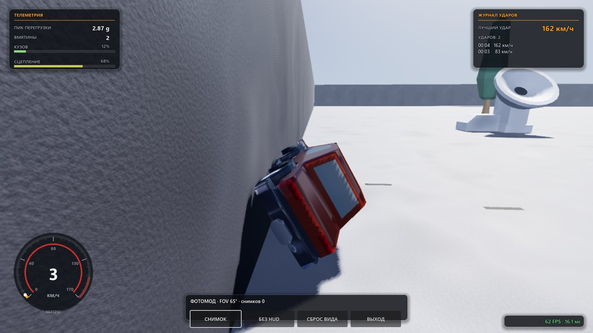
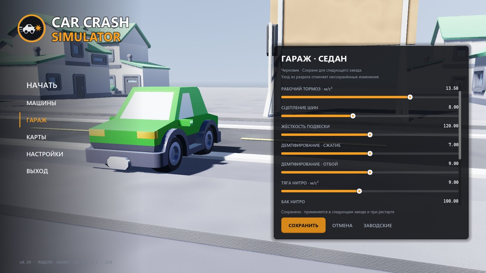
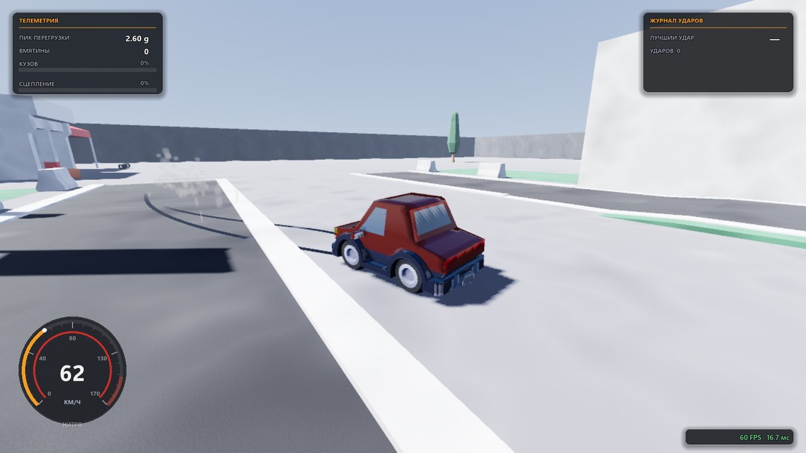

# Car Crash Simulator

[](https://github.com/lightcodegit/carcrashsimulator/actions/workflows/ci.yml)
[](LICENSE)
[](https://godotengine.org/download/archive/)

3D-краш-песочница в духе BeamNG.drive на Godot 4.7: кузов из готовых CC0-моделей
мнётся вмятинами в точке удара, 5 машин, 6 карт, слоу-мо, камера свободной орбиты,
меню и настройки в духе BeamNG.drive (живой 3D-мир под интерфейсом, левая текстовая
навигация, янтарные акценты), HUD заезда — в стиле технической телеметрии.

<p align="center">
  
  
  
</p>

<p align="center"><sub>Смятие и фотомод · гараж с окраской · след резины в заносе. Кадры сняты
живым рендером GL Compatibility, 1600×900.</sub></p>

## Запуск

1. Открой проект в Godot **4.7.2 stable** (импорт папки `carcrashsimulator`, файл `project.godot`).
2. Нажми **F5** — игра запустится с меню.

### Windows / Linux: переносимые команды

Нужны **Node.js >=22** (без npm-зависимостей) и стандартный Godot **4.7.2 stable**,
не .NET. Для экспорта установи шаблоны **4.7.2.stable** через
**Editor → Manage Export Templates** или из
[официального релиза](https://github.com/godotengine/godot-builds/releases/tag/4.7.2-stable).
CI скачивает этот же редактор и шаблоны, проверяя SHA-256.

```sh
node tools/project.mjs --help
node tools/project.mjs import
node tools/project.mjs test
node tools/project.mjs build windows
node tools/project.mjs build linux
node tools/project.mjs run                 # открывает GUI, использует настройки игрока
```

Godot ищется в PATH как `godot`; можно задать переменную `GODOT` или добавить
`--godot "C:/path with spaces/Godot.exe"` к любой команде. `help <команда>` и
`<команда> --help` описывают опции. Корень проекта определяется по расположению
скрипта, а не текущему каталогу. `--timeout 300` задаёт таймаут процесса в секундах:
по умолчанию import/build — 300, каждый тест — 120, run — 3600. Таймаут — ошибка,
не успешное завершение по числу кадров. Import, test и build окон не открывают.

Сборка импортирует временную копию `project.godot`, `assets/`, `scenes/`, `scripts/`
с `tools/export_presets.cfg`: сохраняется GL Compatibility, включаются и динамически
загружаемые ресурсы с лицензиями, исключаются tests/docs/tools. Локальный
`export_presets.cfg`, пути и подписи из него не читаются и не перезаписываются.
Готовые x86_64-релизы: `artifacts/build/{windows,linux}/` (бинарник **вместе с .pck**).
Каталог обновляется только после успешного экспорта; при ошибке там может остаться
прошлая сборка. Логи и JSON-отчёты каждого запуска — `artifacts/logs/`; всё это
игнорируется Git. CI проверяет обе ОС, сохраняет логи всегда, бинарники — только
при успехе, и **обязательно запускает собранный билд** headless на несколько
кадров: «экспортировалось» без «запустилось» в этом проекте сборкой не считается.
После скачивания Linux-артефакта может понадобиться
`chmod +x "Car Crash Simulator.x86_64"`.

### Готовые сборки

Играть без сборки из исходников можно со
[страницы релизов](https://github.com/lightcodegit/carcrashsimulator/releases): каждая версия `v*` публикуется автоматически
workflow-ом `Release` — два архива (Windows и Linux x86_64) с бинарником и `.pck`
внутри. Номер тега сверяется с `application/config/version` в `project.godot` и с
записью в `CHANGELOG.md`, поэтому выложенный архив — это ровно то, что названо
версией. До тега `v*` публикаций нет: конвейер включается только по тегу (или
вручную из вкладки Actions).

## Управление

| Действие | Клавиатура | Геймпад |
|---|---|---|
| Газ / тормоз | W / S | RT / LT |
| Руль | A/D, ←/→ | левый стик |
| Ручник / стояночный (занос, тяга остаётся на передних) | Space | A (крестик) **или** L1 |
| Нитро / форсаж (удержание) | Shift | R1 |
| Слоу-мо (удержание) | Ctrl | B |
| Камера (погоня → капот → орбита) | C | X |
| Рестарт | R | Y |
| Пауза | Esc | Start |

Все действия переопределяются: **НАСТРОЙКИ → УПРАВЛЕНИЕ** (из главного меню и из
паузы) — на клавишу, кнопку или ось геймпада; клавиатура и геймпад хранятся
раздельно. Модификаторы (Ctrl, Shift, Alt, Win) — часть назначения: `Ctrl+F` и `F`
две разные клавиши, они не вытесняют друг друга и так же подписаны в списке;
в `settings.cfg` они живут в токене (`k70+CS`) и переживают перезапуск. Таблица
выше — раскладка по умолчанию.

Названия кнопок на экране настроек берутся из нормализованных индексов Godot, а не
из «очевидной» таблицы SDL: на этой сборке печатью самих констант проверено, что
`JOY_BUTTON_A=0 … START=6, L1=9, D-PAD 11…14`, а курки — это оси 4 и 5 (в покое
0.00, что подтвержено на живом PS4-геймпаде через `p_gamepad`). Ошибка в этой
таблице стоит игроку того, что он не может назначить то, что видит на контроллере.

На паузе игровые действия игнорируются; повторный **Esc** продолжает. Меню паузы — левая колонка
поверх живого мира: шесть текстовых пунктов (продолжить / настройки / реплей удара /
фотомод / запустить заново / в главное меню), сводка заезда и работа со стрелками
и геймпадом.

Машина настраивается мышью или стрелками/геймпадом в **ГАРАЖЕ** главного меню —
см. раздел «Гараж». Геймпад ещё и вибрирует: импульс на ударе и непрерывный гул
на сносе (отдельный тумблер и сила — **НАСТРОЙКИ → ЗВУК**); на живом контроллере
это пока не подтверждено, проверено внедрёнными заглушками.

## Механика машины

Машина — штатный `VehicleBody3D` + четыре `VehicleWheel3D` из Godot: подвеска на лучах,
сцепление шин, скольжение, торможение и разворот считаются движком. `CarRig` добавляет
только то, чего в Godot 4.7 нет:

- **Кривая тяги.** `engine_force` у машины один и постоянный, поэтому тяга падает как
  `1 − (v/vmax)^1.6` и машина асимптотически выходит на паспортную vmax (153 из 160
  км/ч у седана за 18 с, 203 из 210 у спорткара). У «Машины бесконечности»
  `vmax = INF`, и кривая тяги тогда не падает никогда: замер на трассе — 565 км/ч и
  удар в финишную стену на 507 км/ч. Тормоз при этом остаётся в покрышечном пределе,
  иначе машиной, которую не можешь остановить, было бы нельзя играть.
- **Пересчёт сил.** `engine_force` Godot прикладывает к *каждому* ведущему колесу
  (замерено: 4 колеса дают ровно `4·F/m`), а `brake` — импульс за тик, а не сила
  (`brake = 98` даёт 18 м/с²). Поэтому тяга и тормоз делятся на число ведущих колёс,
  а тормоз дополнительно умножается на `dt`.
- **Педаль и предел сцепления.** Торможение ограничено тем, что реально держат шины
  (`BRAKE_MAX_G` ≈ 1.25 g), а давление в педали нарастает за ~0.14 с (`PEDAL_RISE`),
  а не появляется по щелчку. Прежние 2.2–2.7 g (замерено: 94 км/ч за секунду)
  физически невозможны: машина падала в одну точку, и это читалось как
  «мгновенно сбрасывает скорость», а не как торможение. Паспортные `brake_decel`
  теперь тоже в покрышечном диапазоне: от 9.0 м/с² у пикапа до 12.3 у спорткара.
- **Руль по пределу сцепления, но с нижним порогом по радиусу.** Угол передних колёс
  ограничен так, чтобы боковое ускорение не превышало `LAT_ACCEL_CAP` = 18 м/с², и при этом
  радиус поворота не становится меньше `STEER_MIN_R` = 22 м:
  `δ = clamp(atan(a·L/v²), atan(L/22), 30°)`. Пол именно в радиусах, а не в градусах: угол,
  нужный для одного и того же радиуса, растёт с базой (R = L/tg δ), поэтому единый на все
  машины градус оставлял «не поворачивает» длиннобазный лимузин. Второй корень той же жалобы
  найден замером: межосевая база считалась по X (колея ~1.6 м) вместо оси Z (база ~2.9 м),
  то есть была вдвое занижена — и потолок угла, и радиус выходили вдвое меньше допустимых.
  Потолок 1.07 g без нижнего порога на 180 км/ч оставлял 0.5° — руль крутится, машина едет
  прямо. Замер после правки (`h_steering`, три машины на 80/140/200/260 км/ч): курс на 200 км/ч
  меняется на 24.2°/с у спорткара, 24.3°/с у седана и 20.2°/с у лимузина, поворот на 30°
  вписывается в 29–37 м дороги (на 260 км/ч — 44 м), после отпускания руля доворот не больше
  12.2°, скорость держится 95%+. Линейная зависимость угла
  от скорости не спасала — на 150 км/ч шины срывались и машину раскручивало на 70°/с.
- **Ручник.** Блокирует заднюю ось (`SLIP_HANDBRAKE`; занос ~55° за 0.6 с на 80 км/ч,
  ловится отпусканием) и добирает тормоз передней оси — но не колесом, а импульсом по
  корпусу. Причина найдена замером: Godot не применяет `brake` колеса, пока у колеса есть
  `engine_force` (`vehicle_body_3d.cpp`), а на ручнике с зажатым W передние колёса именно
  тянут — поэтому колёсный тормоз передней оси просто не применялся. Замер `h_handbrake_devices` (секунда
  на ~57 км/ч): без доли передней оси 0.47 g с газом и 0.53 g накатом; с ней — 0.74 g с газом
  и 0.81 g накатом, пик одного тика 0.87 g, короткое касание за 0.2 с снимает 6–7% скорости.
  Так ручник остался тормозом для заноса, а не экстренной остановкой: педаль на нём нарастает
  те же 0.14 с, и служебный тормоз в том же тесте — 0.96 g: педаль по-прежнему останавливает
  машину короче ручника.
  У лимузина тормоза подняты до седановских 10.5 м/с²: с 8.0 (замер — 0.67 g накатом)
  двухтонная машина тормозила педали слабее, чем ручником.
- **Нитро.** Форсаж — свойство модели машины, а не строчка в пресете: `nitro_*` живут
  в `VehicleParams` с дефолтами, так что любой новый кузов получает нитро сам (это
  проверяет `h_nitro`: он смотрит и на чистый `VehicleParams.new()`, и на каждую машину из
  `VehicleDB.ids()`). Пока держат Shift с нажатым газом, тяга получает +9 м/с², а потолок
  скорости — надбавку ×1.45: замер на спорткаре 171 км/ч против 102 км/ч за 3 с с места
  и 313 км/ч против 203 км/ч на вершине диапазона. Бак (100 единиц) уходит за 2 с и
  копится обратно за 8; на пустом баке форсаж не зажигается, накатом не расходуется. На
  приборной шкале он показан внутренним кольцом (голубое — есть, оранжевое — горит), из
  заднего бампера идёт пламя: цена — 0.42 мс на кадр (замер живьём: 6.46 → 6.88 мс).
- **Гидроупор подвески.** Хода колёс (0.20 м) на жёсткую посадку не хватает: при
  приземлении с 12 м рама опускается так, что низ коллайдера оказывается ПОД асфальтом, и
  тормозит её дальше уже он, а не резина. Замер: посадка после трассового трамплина на
  270 км/ч стоила 47 g и 110 км/ч всего за пять тиков — «когда машина приземляется куда
  сильно, у неё очень много теряется скорости». Упор считает запас **у четырёх углов**
  коллайдера (лучом вниз от каждого) и давит строго вверх, только пока кузов идёт вниз.
  Углы, а не центр: горка поднимается вперёд, и под носом грань на 17 см выше, чем под
  серединой кузова — центральный луч показывал запас +0.21 там, где нос уже ушёл под
  верхнюю грань гребня и упирался брюхом в торец горки (замер: приземление на склон 4.4°
  с 80 км/ч — 30 g, 1079 км/ч/с и минус 79 км/ч за 12 тиков; `h_slope_land` ловит это снова).
  Запас берётся не нынешний, а до момента касания: `a = g + (vy² − 1.5²)/(2·остаток)`, то
  есть гашение подбирается под высоту падения и заканчивается мягким касанием при 1.5 м/с.
  Потолок — 45 м/с² (4.6 g): без него упор превращался в парашют (спуск 10 м кончался
  касанием при 1 м/с), с ним падение с 12 м на 200 км/ч стоит 17 км/ч/с и 1.3 км/ч
  (`h_landing`). Два правила, без которых упор сам становится багом: **опора — только
  неподвижный рельеф** (`StaticBody3D` с гранью, близкой к горизонтали): сбитый бачок тоже
  даёт верхнюю грань, упор принимал её за пол и выталкивал машину, а из-за скачка нагрузки
  колёс продольная скорость падала на 28 g за тик; и **только на движении вниз** — иначе
  прижатый к стене нос, ушедший под пол, получал вечный подъёмник, и машина не
  останавливалась, а скользила по стене с растущей вмятиной (`h_crash`: 72 км/ч вместо нуля).
- **Дорога не имеет права съедать скорость.** Жалоба «машина рандомно на каких-то объектах
  резко снижает скорость» означает торможение без столкновения, поэтому `h_ghost_brake` ездит по
  всем живым картам посередине полосы на 200 км/ч и на каждом скачке горизонтального
  торможения выше 60 км/ч/с (1.7 g) спрашивает физический мир, кого касается рама. Не у
  кого — это баг. Прежний замер ловил именно это: 56.4 → 51.9 м/с за один тик на ровном
  месте. Нынешний прогон: 5101 тик, 20 скачков, все 20 объяснены (стены финиша, отбойники,
  посадка после прыжка) — необъяснённых ноль. Отбойники у финиша Трассы стоят в своей
  полосе нарочно: пять штук по 25 кг забирают у машины ~20 км/ч на себя, это и есть
  заявленный «снос предметов», а не потеря скорости.
- **Потолок силы подвески** — `SUSP_MAX_G` = 6 g. При 3 g колёса не успевали поднять
  кузов по наклонной грани горки: на 250 км/ч машина билась о неё носом и складывалась
  (подъём 0.45 м вместо полёта). С 6 g тот же заезд даёт 4.6 м высоты и ноль вмятин.
- **ESP и полёт.** Упрощённые шины Godot не гасят начатый занос — сорванную машину не
  поймать даже контррулём. Поэтому при скольжении без ручника растёт `angular_damp`,
  а в воздухе он ещё выше: прыжок заканчивается приземлением на четыре колеса.
- **Детектор удара** — гибель скорости как таковой: падение больше `IMPACT_DECEL`
  км/ч за секунду (~6 g) за окно в несколько тиков, а не сам факт касания. Мерится
  ПОЛНАЯ величина вектора скорости: на гребне горки машина теряет 12 км/ч по горизонтали,
  зато получает +13 м/с вверх, то есть скорость просто повернула. Прежний признак «по
  горизонтали» на 250+ км/ч давал 240 км/ч/с, и трамплин объявлялся ударом — жалоба
  «машины ударяются на рампах». Замер на горке 2.6 м: поперёк полосы и по центру,
  60…300 км/ч, худшее торможение 113 км/ч/с вместо 182.

`VehicleBody3D` едет носом в **локальный +Z** — это проверено замером и расходится с
общей конвенцией Godot «−Z вперёд». Проект живёт в «+X вперёд», поэтому рама повёрнута
на `YAW_OFFSET = +90°`, а кузов внутри неё на `−90°`. `heading` разворачивается по
кратчайшей дуге: `get_euler()` отдаёт рыскание в `[-π, π]`, и на полном круге оно
скачет на 360°.

Три вещи пришлось починить в настройках, иначе физика работала неправильно:

- `physics/3d/default_linear_damp = 0.0` в `project.godot`. `VehicleBody3D` игнорирует
  собственный `linear_damp = 0` и берёт дефолт проекта, а 0.1 съедал треть vmax:
  разгон точно повторял `a = 4·F/m − 0.1·v`.
- Низ коллайдера поднят на `CLEARANCE = 0.22 м` над срезом колёс. Лежащая на полу
  коробка съедала 3.4 м/с² разгона; теперь это ещё и высота ступени, которую машина
  переезжает (бордюры городка — 0.2 м). Вверх коробка описывает кузов целиком: с
  запасом 0.94 нос выступал на 9 см и при ударе проходил сквозь стену.
- Посадка считается, а не подбирается. Луч колеса в Godot имеет длину `rest + radius`,
  но параметр попадания нормируется на `2·radius + rest`, поэтому равновесие наступает
  при `(R+L)·L/(2R+L) = g/(N·k)`. `_suspension_rest()` решает это относительно `L`, и
  на стоянке колёса стоят ровно на земле (замер: `y = 0.360` при радиусе 0.360).

Визуальные колёса ассета следят за физическими: Godot сам двигает узел `VehicleWheel3D`
вдоль подвески (`get_suspension_travel()` — просто геттер свойства), поэтому ход
берётся из смещения узла относительно опоры, а качение — из `get_rpm()`.

Контроллер берёт `dt` из `_physics_process`, а не жёсткое `1/60`: при
`Engine.time_scale` Godot делает то же число тиков в секунду с уменьшенной дельтой,
поэтому разгон, торможение и руль в слоу-мо действительно замедляются.

## Что на экране заезда

HUD намеренно занимает угол кадра, а не центр: четыре элемента — спидометр слева снизу,
панель телеметрии слева сверху, журнал ударов справа сверху и счётчик кадров справа снизу
(настройка). Цифра скорости и подпись «КМ/Ч» рисуются ВНУТРИ циферблата в его нижней
пустоте:
шкала разомкнута снизу (135°…45°), поэтому место там есть, а прежняя отдельная подпись
кладалась ровно на центр круга, где ходила стрелка. Стрелку убрали — её заменяет конец
дуги с точкой на ободе; поверх цифр она шла и в прежнем виде, и в любом новом. Форсаж —
внутреннее кольцо (голубое — есть, оранжевое — горит), подпись «НИТРО» вынесена за круг.

Из панели телеметрии убрано то, что не меняется в заезде или дублирует другое показание:
габарит длины машины, максимальная глубина вмятины (это же рассказывает шкала «кузов») и
текущая перегрузка — она мигает на каждой кочке, а для аварии есть пик и журнал ударов.
Осталось четыре числа и две шкалы. Линейки под заголовками панелей окрашиваются в цвет
выбранной машины (`bind`), чтобы было видно, чьи именно это показания. Всё это
проверяется числами в `h_hud_layout` (картинку смотреть нельзя): геометрия, отсутствие
наложений, состав показаний и доля закрытого кадра.

## Как устроена деформация

Кузов — `DentBody`: меш узла `body` из импортированной модели подразбивается дважды
(704 → 11 264 треугольника) и хранится массивом вершин. Симуляции нет вовсе — пружины,
verlet-интеграция, сон клеток и AABB-барьер удалены. В момент удара вершины в радиусе R
мгновенно смещаются вдоль направления движения: квадратичный спад к краю плюс валик по
периметру (`RIM_*`), глубина растёт со скоростью и ограничена долей высоты кузова
(`MAX_DEPTH_RATIO`). Вершины красятся в «ободранный» цвет пропорционально смещению,
нормали пересчитываются по предвычисленным группам сварки — вмятина читается при плавном
шейдинге. Пересборка меша стоит 6–15 мс (медиана трёх ударов в `h_crash`) и происходит только на ударе, а не каждый кадр.

Направление смятия берётся из вектора потери скорости, поэтому боковой и кормовой удары
мнут свой борт, а не нос. Радиус колеса и его центр тоже меряются по геометрии модели,
а не «на глаз»: у Kenney меш колеса смещён относительно своего узла на 6 см, и
физическое колесо из-за этого повисало над землёй вместе с лучом подвески.

Слоу-мо только ручное (Shift / B): автоматического замедления и баннера «УДАР» нет,
игра не останавливается без команды игрока. Удар попадает в компактный журнал
телеметрии и в лёгкий шейк камеры.

Слоя урона нет: HP зон, TOTALLED, дым и огонь убраны вместе с пружинной моделью.
`EffectsDirector` даёт только искры и пыль в точке контакта, а HUD показывает
телеметрию: скорость, перегрузку, число и глубину вмятин, журнал ударов.

Если машина осталась на крыше (теперь это возможно — подвеска настоящая), HUD
подсказывает нажать **R**; вылет за границы карты делает то же самое.

## Модели и ассеты

`assets/` — два набора Kenney, оба CC0 (лицензии лежат рядом с ассетами):

- **Car Kit 3.1** (`assets/LICENSE-kenney-car-kit.txt`): кузова `sedan` / `truck` /
  `race` (у каждого 4 колеса отдельными узлами, передние поворачиваются, все катятся),
  городские здания, деревья, заборы, клумбы, конусы, ящики и обломки.
  **Лимузин — производная этого же CC0-кузова**: `DentBody.stretch_model()` растягивает
  узел `body` по длине на `params.body_stretch` (1.45) и отодвигает заднюю ось, а колёса
  не трогает — неравномерный масштаб сделал бы из них овалы. Замер: 3.06 м у седана →
  4.68 м у лимузина, пять тех же mesh-узлов, радиус колеса тот же 0.38 м.
- **Racing Kit 1.0.0** (`assets/racing/LICENSE-kenney-racing-kit.txt`): 70 сегментов
  трассы — плиты дорог и повороты, стартовая арка, отбойники, пит-боксы, трибуны,
  тенты, билборды, фонари, флаги, радар, деревья и трамплин `roadRamp`.

Сегменты трассы ставятся через `MapKit.kit()` с trimesh-коллайдером по реальной
геометрии (`backface_collision = true`, иначе лучи проходят сквозь меш). Плиты дорог
имеют высоту 0.2 и топятся на `ROAD_Y`, чтобы полотно легло ровно на y = 0.
Тайл 10×10, полотно 8.37 м по центру, соединения — на краях с y = 0.20; при
`rot_y = 90` дорога идёт вдоль +X.

Рельеф на картах — настоящий. Долгие плиты `roadRamp` и `roadBump` ставились без
коллайдеров (у плоских плит полотно совпадает с физической землёй, а горке нужен
свой), и из этого выходило: машина проезжала трамплин высотой 2.7 м, не оторвавшись
от невидимого пола (замер — 0.38 м подъёма), а сбитый предмет проваливался внутрь
бугра. Теперь у них trimesh по граням самой модели — коробка поставила бы ступеньку,
о которую машина теряла скорость. Прыжок вернулся: 89 км/ч → 4.76 м высоты и
приземление через 40 м без единой вмятины. Лежачий полицейский Kenney при этом
оказался горкой в 1 м: оживив его, я получил стену (164 → 13 км/ч), так что `kit()`
умеет масштаб, и бугры сжаты по Y (`BUMP_Y` = 0.22, гребень 0.19 м). Верхняя граница не
выбрана на глаз: низ коллайдера рамы — `CarRig.CLEARANCE` плюс 2 см зазора, то есть
0.24 м, и всё, что выше, для машины уже стена. При 0.35 (гребень 0.30 м) на 280 км/ч
кузов упирался в бугор и складывался.

У крутой горки тот же разговор с другой стороны: грань в 15° поднимается на 0.31 м за
тик, а ход подвески 0.20 м, и на 250 км/ч нос кузова снова в геометрии. Поэтому
трамплин на трассе растянут `ramp(..., stretch = 3.0)` в 30 м (угол 4.4°, 0.09 м за
тик) — высота те же 2.6 м, но машина едет по нему, а не бьётся о него.
тик) — высота те же 2.6 м, но машина едет по нему, а не бьётся о него.

Зато горка оказалась оболочкой. Замер по геометрии `roadRamp`: 18 граней, и 20 рёбер
висят в воздухе — ступени и два боковых торца есть, а **дна и задней стенки нет**. Машина,
оказавшаяся за трамплином, входила в открытый торец и пропадала внутри (замер: задним ходом
на 60 км/ч рама доходила до x=93.7 при горке x=60..120 — 26 метров внутри геометрии), а
назад горка была насквозь прозрачная: «сзади трамплинов можно пройти сквозь них, и вообще
они невидимые сзади». `kit()` теперь замыкает коллайдер сам — дно и оба торца по нижним
кромкам меша, — а там, где отверстия больше полуметра, задняя стенка рисуется отдельным
узлом-оболочкой в локальных координатах сегмента. Узлом, а не новым мешем: и три теста, и
сам `MapKit` узнают плиту по `resource_path` её меша, и подменой меша на собранный в коде
эта идентичность терялась. Дно не рисуется (его не видно), стенка начинается от подола
сегмента (ниже — провисание, которое считает h_map_props), и ставится только там, где торцевая
грань действительно отсутствует. Цена: +1 объект отрисовки на трамплин — 0 на арене и в
городке, по 1 на «Трассе» и «ГОНКЕ», 10 на «БЕСКОНЕЧНОСТИ» при 481 плите. Проверка —
`h_ramp_solid`: 9 лучей с тыла обязаны попадать в горку, нарисованная стенка обязана быть (2
треугольника, высота 5.2 м), и машина задним ходом обязана остановиться о торец, а не
оказаться внутри него.

Карты: **Арена** — испытательная петля (прямая, разворот `roadHalfCircle`, обратная
прямая), лежачий полицейский, слалом из пилонов, пит-боксы, трибуны и краш-блок.
Трамплина на арене больше нет: от горки до стены 70 м, а прыжок с неё летит дальше
(замер: 140 км/ч → 70 м, 210 км/ч → 190 м), то есть кончается ударом о стену или
вылетом за карту — те самые «удары на рампах». Краш-блок и конусы убраны с исходящей
прямой в коридор обратной. **Городок** — кварталы зданий City Kit, две улицы из дорожных плит,
тротуары-бордюры (на них можно заезжать), фонари, билборды, заборы и припаркованные
машины. **Трасса** — 620 м полотна из `roadStraightLong`, стартовая арка, трамплин в 30 м,
отбойники по всей длине, пит-лейн с боксами и трибунами, бетонная стена на финише.

**ГОНКА** — замкнутое кольцо около километра: 280 м стартовой прямой с трамплином
(5.2 м высоты на 60 м — те же 5°, что и посадочная горка трассы, иначе на 250 км/ч нос
кузова упирался в грань), два поворота радиусом 25 м и два по 15 м, обратная прямая с
лежачим полицейским, инфилд со слаломом из пилонов, трибуны, боксы, мачты, щиты и
отбойники по обоим поясам. Кольцо собирается `TrackCursor`-ом по измеренным якорям
тайлов: правые развороты чередуются 25/15/25/15, противоположные прямые равны — при
таком раскладке сумма смещений по обеим осям равна нулю, и хвост совпадает с началом
(замер: незамыкание 0.00 м; проверяет `h_newmaps`).

**БЕСКОНЕЧНОСТЬ** — лента плит, которая не кончается: `MapDB.recycle()` переставляет
то, что осталось за спиной, в хвост (шаг = число плит × 20 м), а пол под ней — одна
плита на 40 км, так что коллайдеров на длину заезда не тратится. Плита и её
незаменяемый наклонный коллайдер уезжают парой: у `kit()` тело стоит ровно в той же
точке, что и меш, и по отдельности они разъехались бы — горка осталась бы невидимым
коллайдером посреди дороги (тот же класс ошибок, из-за которого предметы проваливались
в бугры). Мачты, щиты и конусы у обочин стоят на месте: предметам известно только
плоское полотно.

Габариты машины производятся от модели: равномерный масштаб подбирается по целевой
ширине `params.width` (неравномерный превратил бы колёса в овалы), а полученные длина,
высота и радиус колеса записываются обратно в `VehicleParams`. Поэтому коллайдер,
капотная камера и клармп стены согласованы с визуалом, а модели стоят колёсами ровно
на y = 0.

## Свет, материалы и сбиваемые предметы

Kenney отдаёт плоский диффуз: у импортированных материалов `roughness = 1` и
`metallic = 0`, то есть specular отсутствует вовсе. Из-за этого асфальт выглядит
бумагой, а кузова в тени домов — почти чёрными (на это и была жалоба). `Materials`
дублирует материал автора и добавляет только PBR-параметры, цвета не трогая:

- **кузовная краска** — лак (`clearcoat`), `roughness 0.28` и низкая металличность:
  блеск даёт именно лак, потому что metallic гасит диффуз и машина чернеет. Та же
  краска у машины игрока, у припаркованных в городке и у машины в живом фоне меню.
- **асфальт, трава, бетон, отбойники** — шероховатость и нормали из одного
  бесшовного перлинового шума (`NoiseTexture2D`), трипланар в мировых координатах,
  поэтому зерно совпадает на стыках плит и не плывёт по вертикальным граням.
  Диапазон шероховатости сдвинут градиентом к светлому, иначе среднее 0.5
  затемнило бы всё вдвое.
- **пятнистость крупных поверхностей** (`detail_albedo`) — второй слой того же рода,
  но во втором UV-наборе со своим мировым трипланаром и масштабом ~18 м на текстуру:
  заплатки и потёртости на асфальте, сухие и тенистые проплешины на траве, разводы
  на бетоне. Именно плоский диффуз Kenney, а не освещение, делал карты мультяшными.
  Середина градиента полностью прозрачна, поэтому цвет автора проглядывает.
- кэш материалов строится по имени материала **и оттенку**: `grey` в
  `roadStraightLong.mtl` и в `barrierWhite.mtl` разные, и общий материал
  перекрасил бы чужие объекты.

Окружение: физическое небо (`PhysicalSkyMaterial`, рассеяние Рэлея и диск солнца)
как источник рассеянного света и отражений, ACES-тонмаппинг, дымка с
`aerial_perspective` (прячет границу прорисовки на 620-метровой трассе), SSAO и
SSIL — экранный непрямой свет вытаскивает из черноты то, что не освещено солнцем
напрямую. Тени на 260 м с 4 split'ами и мягкой границей (`light_angular_distance`).

Сбиваемые предметы (`LooseProp`, `RigidBody3D`): конусы, пилоны, покрышки, ящики,
обломки и маленькие пластиковые отбойники. Конус улетает на 20 м, кувыркается и
поднимается на 1.5 м, отнимая у машины 3% скорости; тяжёлый отбойник — 5%.
Здания, отбойники трассы, фонари, трибуны и деревья остаются статичными.

Пол и плиты дорог намеренно с нулевым трением — иначе машина теряет скорость от
любого касания, о чём просил игрок. Плата за это: Bullet перемножает трение контактной
пары, и 1.0 предмета о 0.0 пола даёт те же нули, так что сбитый конус ехал 7 секунд и
всё ещё летел на 24.5 м/с. Гасится сам предмет: `linear_damp` 1.6 и `angular_damp` 2.4
в режиме REPLACE (в проекте `default_linear_damp = 0`, и ADD прибавлял бы ноль к
материалу, а не значение предмета). Тот же замер после правки — 0.05 м/с.

Solver Godot при встрече двух axis-aligned коробок бьёт почти точно через центр
масс, поэтому без добавки предмет не кувыркается, а едет перед бампером как отвал
бульдозера. `LooseProp` на контакте добавляет момент импульса вокруг поперечной
оси — ровно то, что в реальности даёт удар бампером выше основания.

## Следы резины

`SkidMarks` чертит полосу там, где колесо действительно скользит: `CarRig` отдаёт
для каждого колеса силу скольжения (блокировка ручником или боковой увод выше
`SKID_SLIDE_START`, помноженная на скорость — стоящая машина следов не оставляет),
а точка контакта берётся как позиция узла колеса минус радиус: высота покоя
подвески равна радиусу, так что это и есть уровень полотна.

Кольцо на 2048 сегментов живёт в одном `MultiMesh` — это один draw call на все
следы сразу. Полосы стареют: у слота есть время рождения, а курсор снятия идёт
вдоль кольца (времена в нём идут по порядку, так что это O(1) на тик, а не обход
2048 записей) и прячет то, что старше `Settings.skid_life` — по умолчанию 30 с
игрового времени. `skid_life = 0` возвращает старое поведение: полосы уходят
только когда кольцо перезапишет их. Насыщенность
полосы задаётся цветом инстанса — лёгкий увод серый, блокировка чёрная. Длина
сегмента берётся из реально пройденного колесом пути с запасом на ширину, поэтому
полоса непрерывная; скачок больше `MAX_LEN` (респавн или приземление после прыжка)
рвёт след, а `respawn()` обнуляет «живые» колёса, чтобы не прочертить мазок через
всю карту.

`Basis.scaled()` умножает матрицу слева, то есть масштабирует строки, а не столбцы:
на повёрнутом базисе это смешивает ширину с длиной. Поэтому оси полосы задаются
явно — `Basis(side * WIDTH, UP, dir * length)`.

## Настройки и производительность

Симуляция стоит **≈1 мс на физический тик** (6–7% бюджета шага 16.67 мс) —
замерено `p_bench` на всех трёх картах. То есть тормозит не физика и не сборка
карты (63–183 мс один раз при входе), а рисование.

### Почему web-сборка шла ровно, а нативная — нет

Причина не в «тяжёлых ассетах», а в **движке рендера**. Web-сборка Godot 4
физически не может рисовать иначе, чем через Compatibility (WebGL2), а нативная
Linux-сборка по умолчанию берёт Vulkan Forward+. На одном и том же содержимом
при 1600×900 на Intel HD 630 (замеры `p_perf`, живой рендер, GNOME/Wayland):

| конфигурация | Compatibility (OpenGL) | Forward+ (Vulkan) | Mobile (Vulkan) |
|---|---|---|---|
| только геометрия, без теней и пост-эффектов | **9.3–9.5 мс** | 18.5–19.3 мс | 22.7 мс |
| + короткие тени (120 м) | 14.5 мс | — | — |
| всё включено (прежний дефолт) | 32.4 мс | 78.4 мс | — |
| **текущий дефолт** | **13.4 мс** | — | — |

Forward+ здесь не спасить ничем: его кадр упирается в ~16.7 мс **на процессоре и
пропускной способности** и почти не зависит от внутреннего размера кадра (при
масштабе 0.5 и 0.6 было 16.9 и 16.7 мс — то есть упор не в пиксели). Пустая сцена
с камерой стоит 1.45 мс, так что 8 мс — это сама картинка, а не движок «в вакууме».

### Почему «30 fps при любых настройках»

Бюджет кадра на 60 Гц — 16.7 мс, а под Wayland композитор **не даёт приложению
отключить вертикальную синхронизацию** (Godot честно пишет
`The requested V-Sync mode Disabled is not available`). Кадр длиной 18.5 мс не
влезает в интервал и уезжает в следующий: игрок видит ровно 30 fps и ничего не
понимает, потому что между 16.7 и 33.3 мс частота не падает плавно, а спрыгивает
ступенькой. Отсюда и второй вывод: выключать эффекты «до нуля» бессмысленно, если
сам движок стоит на границе — надо влезать в 16.7.

### Почему машины шли «отрывками»

Физика считается 60 раз в секунду, а картинка на этом железе строилась в ~2 раза чаще
(145 fps). Без интерполяции каждый второй кадр рисовал ТУ ЖЕ позицию: замер на живой
сцене — 44…58% кадров стояли на месте. Отсюда и «машины идут отрывками иногда» —
дело было не в лагах, а в том, что большинство кадров не обновляли положение. Включён
`physics/common/physics_interpolation=true`, и движок сам выводит позиции между
тиками. Два следствия, оба закрыты кодом: телепорт (рестарт) обязан звать
`reset_physics_interpolation()`, иначе машина рисуется разъездом от старого места к
новому, а камера ведётся из `_process` и потому исключена из интерполяции
(`PHYSICS_INTERPOLATION_MODE_OFF`) — иначе движок предупреждает
«Interpolated Camera3D triggered from outside physics process».

### Почему камера отставала и «мелькала» на скорости

У жалобы два корня, и оба — следствие той же интерполяции.

Первый: погоня догоняла `chassis.global_position`, то есть позицию **тика**, а на экран
машина уже вышла в интерполированную точку. На 150 км/ч между ними путь за один тик —
0.7 м, и знак этого зазора менялся каждый кадр: камера отставала, догоняла и снова
отставала. Теперь всё, что следит за машиной, берёт `CarRig.render_transform()` —
`get_global_transform_interpolated()`, ровно то положение, которое рисуется.

Второй: позиция погони сглаживалась `lerp`-ом самой себя. Сглаживать положение машины,
которая едет, — значит вечно не добирать дистанцию: замер живьём на 150 км/ч давал 0.66 м
лишней дистанции и дрожание 0.091 м в среднем (0.5 м в худшем кадре). Погоня переписана как
чистая функция от рисуемой машины: `позиция = машина − курс·back + вверх`, где
сглаживается только **курс** (`SWAY_RATE`, 6 1/с). Позицию больше нечем не добрать, и в
повороте камера по-прежнему доворачивает следом, а не телепортируется. Замер тем же
тестом: отставание 0.00 м на всём разгоне до 152 км/ч, среднее дрожание 0.004 м,
худший кадр 0.014 м (600 кадров живьём, на скорости выше 100 км/ч).

### Почему открытые карты дороже закрытой

Замер одного и того же рендера живьём (1600×900, пресет СРЕДНИЙ, без скриншотов):
Арена — 6.5 мс на кадр, Трасса / ГОНКА / БЕСКОНЕЧНОСТЬ — 33-35 мс. Разница не в
освещении и не в тенях (отключение теней у мелкого пояса дало 1.7 мс из 35): на
просторной трассе в кадр попадает в несколько раз больше плит, отбойников и щитов, и на
встроенной GPU это упирается в число вызовов отрисовки. Честный ответ здесь — не
настройки картинки, а один проход по видимости (пакетная отрисовка однотипных тайлов
или отсечение по дистанции); пока карты держат тот же бюджет, что и Трасса, — новых
жертв производительности ГОНКА и БЕСКОНЕЧНОСТЬ не принесли.

### Цены эффектов (Compatibility, 1600×900, от базы 9.45 мс)

| что включить | цена |
|---|---|
| MSAA 2× / 4× / 8× | +3.3 / +5.7 / +9.1 мс |
| тени 260 м | +5.2 мс |
| SSAO | +7.3 мс |
| свечение яркого | +3.9 мс |
| дымка | +2.0 мс |
| экранный сглаживатель (FXAA) и SSIL | на этом движке не работают |

MSAA считался отдельным запуском на холодную: переключение MSAA на лету внутри
одного процесса цену не показывает (буфер не пересобирается), и замер врёт.

### Пресеты и два режима настроек

`НАСТРОЙКИ → КАРТИНКА` открывается базовым набором; переключатель «РАСШИРЕННЫЙ
РЕЖИМ» показывает остальные ~15 пунктов (тонмаппинг, экспозиция, точка белого,
яркость свечения и bloom, плотность дымки, воздушная перспектива, рассеяние
солнечного света, радиус и сила SSAO, мягкость солнечных теней, рассеянный свет,
поле зрения и тряска камеры, фактор слоу-мо). Страница прокручивается: в базовом
режиме пунктов не 24, и без прокрутки последние уезжали бы за край панели.

Пресет («КАЧЕСТВО КАРТИНКИ») выставляет всё сразу; цена измерена холодным стартом
на Intel HD 630 при 1600×900:

| пресет | кадр | влезает в 60 fps здесь? |
|---|---|---|
| НИЗКОЕ | 6.7 мс | да |
| СРЕДНЕЕ (по умолчанию) | 13.7 мс | да |
| ВЫСОКОЕ | 29.4 мс | нет, это для дискретной GPU |
| КИНО | 29.2 мс | нет: мягкие тени 420 м, bloom, воздушная перспектива на полную |

Тронуть любой пункт вручную — и пресет переключится на «СВОЁ»: иначе отметка врала
бы, что картинка всё ещё «средняя».

### Что теперь по умолчанию

`Compatibility` как движок проекта (совпадает с web-сборкой — одна картинка везде),
MSAA 2×, тени 120 м, свечение и дымка включены, SSAO/SSIL выключены, внутренний
масштаб 3D — 0.7. Это **13.4 мс/кадр** на том же железе, то есть честные 60 fps с
запасом на движение, следы резины и вмятины. Кто хочет максимум — включает всё в
`НАСТРОЙКИ → КАРТИНКА` (на этой машине «всё» = 32 мс, то есть 30 fps) либо
запускает прежний конвейер: `godot --path . --rendering-driver vulkan
--rendering-method forward_plus`.

Файл `user://settings.cfg` переживает смену дефолтов: если игрок когда-то выкрутил
картинку «на минимум» в борьбе с лагом, его значения останутся и после обновления —
это правильно (не надо топать чужие настройки) и потому чинится кнопкой **СБРОСИТЬ
ВСЁ** на экране настроек, а не молча.

- `НАСТРОЙКИ → КАРТИНКА` даёт игроку самому менять стоимость кадра: масштаб
  картинки, тени, MSAA, SSAO, SSIL, дымку, свечение, потолок кадров и вертикальную
  синхронизацию. Пункты, которых нет у выбранного движка (экранный сглаживатель и
  SSIL на Compatibility), не показываются вовсе: настройка, которая ничего не
  делает, хуже, чем её отсутствие;
- полотно плит легло вровень с физической землёй (2 мм): раньше верх пола был на
  1 см НИЖЕ дна дорожной «ванны», то есть машина ехала по невидимому полу, а
  асфальт с разметкой оставался под колёсами;
- невидимая работа убрана в коде: плоские дорожные плиты и пол не бросают тень
  сами на себя (на трассе это 336 → 299 draw call'ов), а `p_bench` следит, чтобы
  симуляция не расползлась.

Интерфейс разложен по сетке 1600×900, но движковое растяжение 2D выключено
(`window/stretch/mode` не задан — это дефолтный `disabled`): масштабирование
`canvas_items` передёргивает уже отрисованные глифы (замер `h_pixelscale`: контраст
края шрифта 16 px падает с 0.675 до 0.471 при коэффициенте 1.2). Поэтому на экранах
выше 1700 px интерфейс растёт целыми ступенями через `UiTheme.step()` — шрифты,
иконки, отступы и ширины умножаются, — а панели прижаты к фактическим углам окна:
журнал не обрезается и не висит в середине экрана (проверяют `h_uiscale` и
`h_hud_layout`).

## Гараж

`ГАРАЖ` — шестой пункт навигации: под ним тот же живой облёт выбранной машины, а
справа — черновик конфигурации. Один сохранённый профиль на машину, именных
наборов нет.

- **Что крутится:** тяга (0.5–1.5 от заводской), рабочий тормоз (6…16.19 м/с²),
  сцепление шин (4–14), жёсткость подвески (60–180), демпфирование сжатия
  (3.5–10.5) и отбоя (4.5–13.5), тяга нитро (2–18 м/с²) и бак (50–200),
  цвет окрашиваемых панелей и металличность/шероховатость финиша.
- **Потолок тормоза — физический,** а не украшение ползунка: `CarRig` всё равно
  ограничивает педаль `BRAKE_MAX_G × g = 16.19 м/с²`, поэтому выше этой точки
  ползунок ничего бы не менял и потому до неё же и обрезан.
- **Окраска трогает только кузов.** `Kenney Car Kit` — атлас 8×4 ячеек, и цветная
  ячейка кузова (`sedan`/`race` — 6×1, `truck` — 3×1) перекрашивается со
  сохранением оттенка (яркость каждого пикселя остаётся множителем), а стекло,
  фары и резина остаются своими пикселями; для финиша поверх ставится маска,
  возвращающая заводской металл/лак на непокрашенных ячейках.
- **Черновик, а не запись:** предпросмотр и витрина меняются сразу, на диск
  уходит только `СОХРАНИТЬ`. `ОТМЕНА` возвращает сохранённое, `ЗАВОДСКИЕ` —
  сбрасывает черновик, уход из раздела тоже сбрасывает несохранённое.
- **Файл `user://garage_v1.json`** версионирован и пишется атомарно (во временный
  файл, затем переименование): битый или слишком большой файл не обрывает загрузку,
  игра берёт заводские значения и объясняет это в статусной строке; файл будущей
  версии не перечитывается вовсе. Границы значений проверяются и при загрузке.
- Профиль доходит до живой сцены: `GameManager` собирает машину из
  `GarageProfiles.effective_params()`, поэтому настройки видны и в заезде,
  и после рестарта карты. Заводская таблица `VehicleDB` при этом остаётся нетронутой.

## Звук, вибрация и частицы

**Звук генерируется, а не проигрывается** — ни одного аудиофайла в `assets/` нет и
библиотеки звуков не нужно. `AudioMixer` — чистый DSP без узлов и без Godot-вывода:
по заказу отсчётов он выдаёт `PackedFloat32Array`, и потому тестируется в headless
до границы вывода (`d_audio_mixer`).

- **Мотор — импульсный ряд по частоте вспышек.** Рядная «четвёрка»: вспышек за
  оборот `CYL/2`, то есть `Гц = обороты/60 × 2` — обороты берутся с реально
  касающихся колёс, поэтому визг в повороте и просадка на льду звучат своими
  оборотами, а не скорость по спидометру. Каждый импульс — быстрый разряд
  (`PULSE_DECAY_S` 11 мс) плюс субгармоника подлиннее (34 мс): отсюда низ.
  Поверх — доля шума 16 %, и всё это одним циклом, за который считается и пик блока.
- **Удар — burst со скользящим срезом**: шум стартует с 7000 Гц (свист металла) и
  за 0.16 с гаснет, опуская срез до 260 Гц (гул). Порог — 15 км/ч потери, полная
  амплитуда с 190 км/ч.
- **Визг резины и струя нитро** — полосовые шумы со своими огибающими; источник,
  у которого нулевая амплитуда, не считается вовсе (профиль: тишина дешевле
  разгона).
- **Граница вывода — `AudioDriver`.** Один `AudioStreamPlayer` + `AudioStreamGenerator`
  на процесс: сцена его не создаёт и не убивает (освобождение плеера вместе с деревом
  заезда давало `access violation` на выходе из процесса). Шина `SFX` создаётся
  программно, громкость крутит `AudioEffectAmplify` — `AudioEffectVolumeFader` в этой
  сборке движка нет. `AudioServer.get_driver_name() == "Dummy"` (headless, CI) — и
  генератор не заводится вовсе: кадры проверются до границы вывода, а тест печатает
  `PARTIAL`, а не выдаёт ложный pass.
- **Стоимость измерена** (`p_audio_perf`, 44.1 кГц): путь одного звукового кадра —
  0.077 мс в тишине (1.29 % реального времени), 2.57 % на 3000 об/мин, 4.0 % на
  6500 + нитро, 5.14 % (0.316 мс) с визгом; с настоящим `push_buffer` в живом окне
  0.70–0.74 мс/кадр, то есть 4.2–4.5 % шага 16.67 мс.

**Вибрация геймпада** (`VibrationFeed`): удар — короткий импульс, снос машины —
непрерывный гул по скольжению, ноль на паузе, рестарте и выходе из сцены; сила —
общий множитель `СИЛА ВИБРАЦИИ`. Вызовы `Input.start_joy_vibration` идут через
внедряемые callable, поэтому путь проверяется без железа; в живом окне с
XInput-контроллером `h_vibration` проходит без `PARTIAL` — то есть настоящий
`Input.start_joy_vibration` вызывается на реальном устройстве (ощущение моторов
глазами и руками движка не измеряется: API не отдаёт обратную связь). Устройство
берётся из `InputRouter.pad_index()`, которое запоминает девайс, приходивший по
`_input`, и обновляется при перебинде.

**Частицы — `CPUParticles3D`, не GPU**: движок проекта детерминирован, а CPU-системы
одинаково считаются и в headless-прогоне. Дым покрывает ту же границу, что и след
резины (тот же `SkidMarks.MIN_SKID`), поэтому дым и чёрная полоса появляются
одновременно; облако дыма — 0.35–0.95 м на 1.15 с, и это число взято не «на глаз»:
первый вариант в 0.12–0.34 м формально дымил (эммитер включён, счётчик дыма
совпадает со следом), но живым кадром не читался вообще — поймано `p_live_probe`
на скриншоте заноса; искры — боковой скребок (луч-«усик» 0.5 м от борта, не раньше 30 км/ч,
контакт должен продержаться 0.08 с, следующий залп не чаще 0.13 с); обломки — на
ударе, 10–30 частиц по скорости; пламя нитро — из-за заднего бампера, в мировых
координатах, чтобы на 200 км/ч язык оставался за машиной, а не летел с ней.
Эммитеры дыма живут у самого `EffectsDirector`, а не внутри `VehicleWheel3D`: колесо
освобождается вместе с машиной, и активный эммитер на этом освобождении обрывал
процесс (4 пересборки городка = AV без принтов).

Настройки — пятая вкладка `ЗВУК`: `audio_enabled`, `audio_volume`, `vibration_enabled`,
`vibration_strength`, `particles_enabled` (там же переключатель частиц).

## Реплей удара

`ПАУЗА → РЕПЛЕЙ УДАРА` показывает, как именно случилась авария. Повтор — это
**проигрывание записанного, а не пересимуляция**: мир на время повтора стоит на
той же паузе, что и меню, и физика не делает ни одного шага.

- **Кольцо кадров.** `ReplayRecorder` пишет `RATE = 20` снапшотов в секунду
  симуляции и держит `HORIZON_S = 10` секунд: 200 кадров, ~28 КБ (замер в
  `h_replay`: «окно 200 кадров = 28.1 КБ»). Симуляционное время, а не часовое —
  поэтому слоу-мо внутри окна остаётся слоу-мо и на повторе.
- **В кадр попадает:** трансформ шасси, скорость, доля бака и горение нитро,
  скольжение, поза каждого колеса (ход подвески, угол поворота, накопленное
  качение — тем же `CarRig.wheel_pose()`, что и живой тик, а не второй копией
  формулы), а из предметов — только сбитые и те, что в 45 м от машины.
- **Вмятины — события, а не геометрия.** Удар пишется как `{t, точка и
  направление в пространстве меша, скорость}`. На перемотке кузов пересобирается
  с нуля из событий до курсора, потому что геометрия вмятины — чистая функция от
  этого списка: до начала окна кузов целый, к концу — с вмятинами того же
  захода. Точки мнутся в локальных координатах специально: мировой вектор удара
  попал бы в другую панель, ведь на повторе машина стоит в другой позе.
- **Возврат точный.** На входе плеер прячет живое состояние (поза и скорости
  шасси, позы затронутых предметов, геометрию кузова) и на выходе возвращает его
  целиком — иначе «посмотрел повтор» стоил бы потерянной вмятины или сдвинутого
  мира. Проверено микрометрами: машина после выхода не уползла ни на метр,
  глубина вмятины та же.
- **Управление:** старт за секунду до последнего удара, ×0.25 по умолчанию
  (0.25 / 0.5 / 1 / 2), шаг по кадру, пауза/пуск, выход. Полоса лежит поперёк
  нижнего края и не задевает ни спидометр, ни счётчик кадров; `Esc` выходит в
  заезд, `R` — выходит и рестартит.
- **Окно = один заход.** Рестарт и `_respawn_now` обнуляют кольцо: повтор через
  телепорт показывал бы прыжок машины, а не аварию.
- **Реплей молчит и не курит:** звук и вибрация на паузе уже выключены, частицы
  и следы резины замирают вместе с физикой. Телеметрия при этом живая — шкалы и
  счётчик вмятин читают проигрываемый кадр, поэтому повтор показывает и то, что
  происходило с кузовом.

## Фотомод

`ПАУЗА → ФОТОМОД`: тот же замороженный мир, но камера — своя, свободная.

- **Навигация:** ЛКМ + движение мыши — курс и наклон (потолок ±77°, дальше
  камера не переворачивается), `WASD` + `QE` — шаг, `Shift` — втрое быстрее,
  колесо — подъехать, `Ctrl`+колесо — уже/шире по углу (12…110°), `F5` —
  спрятать интерфейс. Управление мышью вне `InputMap` намеренно: оно не должно
  конфликтовать с назначенными игроком биндами езды. Отдельных клавиш-зумов
  больше нет именно поэтому, а `F5` уступает, если игрок поставил на неё своё
  действие.
- **Снимок без интерфейса.** Кнопка `СНИМОК` сначала гаснит и игровые панели, и
  собственную полосу, пишет кадр на следующем процесс-тик и возвращает интерфейс
  ровно в то состояние, где был до съёмки — иначе полоса фотомода попадала бы
  на каждый кадр. Если выйти раньше этого тика, кадр всё равно пишется.
- **Старт вида:** угол камеры берётся у игровой камеры, так что вход показывает
  ровно тот вид, который был у игрока, а не прошлый зум.
- **Куда ложится:** `user://photos/photo_0001.png`, нумерация продолжается с
  числа файлов на диске, а не с нуля, и переживает выход из фотомода и смену
  сцены. Путь и счётчик видны в подписи полосы.
- **Возврат:** `ВЫХОД` или `Esc` выключают камеру фотомода, вьюпорт сам
  возвращает статус игровой камере (проверено), интерфейс снова целый, машина
  едет дальше. `СБРОС ВИДА` ставит камеру туда, где стояла игровая.

## Структура

```
assets/           CC0-модели Kenney Car Kit и Racing Kit + лицензии
scripts/core/     car_rig (VehicleBody3D), dent_body, materials, effects_director
                  (частицы: дым, искры, пыль, обломки, пламя), camera_rig (без
                  столкновений со стенами), skid_marks, game_manager,
                  vehicle_params, vehicle_db, garage_profiles (user://garage_v1.json),
                  audio_mixer (чистый DSP: мотор, визг, нитро, удар),
                  audio_driver (граница вывода: AudioStreamGenerator + шина SFX),
                  vibration_feed (импульс на удар, гул на снос),
                  replay_recorder + replay_player (кольцо 10 с и проигрывание без
                  пересимуляции), photo_mode (свободная камера и PNG в user://photos)
scripts/maps/     map_db (фасад: ids / build / recycle / отладочная статистика),
                  map_defs (числа и палитра), map_kit (пол, плиты, киты, поверхности),
                  map_props (пропы, сбиваемые предметы, городская мебель),
                  map_circuit (кольцо и «бесконечность»), map_arena / map_town /
                  map_bigcity / map_speedway, loose_prop (физика сбиваемого предмета)
scripts/ui/       ui_theme (янтарные токены и фабрики контролов), main_menu
                  (живой 3D-фон, левая навигация, разделы), garage_panel (тюнинг и
                  окраска: черновик · сохранить · отмена · заводские),
                  hud (телеметрия, пауза: шесть пунктов, полоса реплея, полоса
                  фотомода),
                  settings_menu (вкладки, пресеты-карточки, таблица биндов)
scripts/autoload/ GameContext, TimeScale, InputRouter (раскладка + переопределение),
                  Settings (user://settings.cfg)
tests/            data-тесты, интеграционные харнесы, скриншот-раннеры
docs/superpowers/ спека и план внедрения (описывают прежнюю пружинную модель)
```

## Тесты

```sh
node --test tools/project.test.mjs          # тесты самого раннера, Godot не нужен
node tools/project.mjs import              # сначала импортировать ресурсы и классы
node tools/project.mjs test --list
node tools/project.mjs test --test d_assets --test h_crash --timeout 180
node tools/project.mjs test                # весь автоматически найденный набор
node tools/project.mjs test --fail-on-skip  # строгий режим: partial/skip тоже ошибка
```

Раннер находит `tests/**/d_*.gd` и `tests/**/h_*.tscn` (сейчас 63), но не
диагностику `p_*`. `--test` принимает точные имена из `--list`, без расширения.
Каждый тест получает новый каталог в системном temp и изолированные
`APPDATA`, `LOCALAPPDATA`, `HOME`, `USERPROFILE`, `XDG_*`; после завершения каталог
удаляется. Настройки игрока и результаты соседних тестов не подменяют дефолты.

Успех требует отдельной строки `ALL PASS`, кода 0 и отсутствия `SCRIPT ERROR`/`FAIL`.
`--quit-after` не используется: зависание, отсутствие маркера и таймаут — ошибки.
`NOTE` — информационный маркер; `PARTIAL`/`SKIP` в завершившемся смешанном тесте дают **partial**, не полный pass
(консервативно также для условных сценариев посадки и рамп). Без геймпада
`h_handbrake_devices`, `h_padflow` и `h_vibration` проверяют лишь клавиатуру либо
внедрённые заглушки и сообщают partial; `h_chase_shake` и `h_debug_overlay` не
проверяют живые кадры/счётчики рендера, `h_garage` — раскладку гаража без
GPU-картинки, `h_audio` — сам вывод при `Dummy`-аудиодрайвере (в headless
генератор не заводится, данные проверяются до границы вывода), а `h_photo` —
живой пиксель снимка: в headless текстура вьюпорта пуста, поэтому проверены путь,
имя, счётчик и подпись PNG по байтам (захват подменён заглушкой).

Полностью исключены из headless-запуска, но перечислены в отчёте как **skipped**:
`h_picture` (нужен GPU-кадр), `h_pixelscale` (экранная сетка), `h_fullscreen`
(настоящее окно), `h_embed_guard` (окно-хост редактора и `--wid`). Для полного
покрытия нужны отдельные ручные прогоны с живым окном и геймпадом; CI их не имитирует.
Такие прогоны сделаны: с подключённым XInput-геймпадом `h_vibration`, `h_padflow` и
`h_handbrake_devices` проходят в живом окне без partial-строки (ручник на живом
джойстике даёт те же 0.74 g, что и с клавиатуры), а `p_live_probe` проверяет звук,
дым, окраску гаража, реплей и фотомод пикселем и настоящим аудиовыводом.
Обычный CI допускает partial/skip, но считает и показывает их отдельно от pass;
прогон на GitHub Actions зелёный на ubuntu и windows, включая экспорт обеих
платформ (30 МБ linux, 40 МБ windows с pck).
Диагностика/скриншоты `p_*` по-прежнему запускаются вручную, вне этой проверки.

Честная граница живого окна: `h_garage` и `h_picture` примерно в одном прогоне из
пяти падают с SIGSEGV ПОСЛЕ `ALL PASS` — то есть на освобождении дерева уже
остановленного процесса, а не на проверке. В headless и в CI это не воспроизводится
(сотни прогонов), собранный `.exe` по закрытию окна выходит за секунду с кодом 0, а
`p_live_probe` с теми же readback-ами падает редко. Причина — гонка на выходе
движка с драйвером Intel, а не код игры; поэтому живой прогон и сделан отдельным
раннером, который перечитывается при подозрении.

Покрытие тестов:

| Тест | Что покрывает |
|---|---|
| `d_params` | пресеты машин (список берётся из `VehicleDB.ids()`), наличие модели, производные габариты, коллайдер внутри кузова; лимузин — самый длинный и самый тяжёлый, медленнее седана, тоже с нитро, а растяжение кузова не делает колёса овальными и уводит заднюю ось назад |
| `h_actions` | autoloads и регистрация экшенов ввода |
| `d_assets` | структура CC0-моделей: `body` + 4 колеса (2 передних), UV, опора на y=0, AABB зданий и пропов, файл лицензии |
| `d_scene_flow` | смена сцены: зажатые клавиши не переезжают в новый заезд, пауза не остаётся |
| `h_dents` | подразбиение кузова, локальность вмятины, монотонность по скорости, накопление, конечность вершин, точный reset, бюджет удара |
| `h_wheels_wall` | колёса (ось поперёк машины, радиус, касание пола), рулёжка только передних, рама и кузов не проходят сквозь тонкую стену |
| `h_vmax_run` | разгон до vmax, торможение, рулёжка, дрифт на ручнике (пик скольжения, угол заноса, скорость доворота) |
| `h_crash` | краш-сценарий: удар 40–170 км/ч, остановка, вмятины, глубина в пределах кузова, ни одна вершина не ушла в стену или под пол, бюджет кадра, вмятины не заживают |
| `h_camera_modes` | три режима камеры, шейк без NaN |
| `h_map_props` | все карты из `MapDB.ids()` (список берётся там, а не записан в тесте): коллайдеры, спавн над полом, спавн не в геометрии, дорожные плиты не наложены друг на друга (иначе разметка мерцает), декорации и припаркованные машины стоят на поверхности, а не под ней и не над ней; горка и бугор твёрдые (луч сверху обязан попасть в рельеф, иначе это декорация) |
| `h_all_maps` | 9 комбинаций карта×машина, вмятина и её сброс респавном, кузовная краска (лак, глянец, низкий metallic), небо/туман/SSIL/длинные тени |
| `h_flow` | респавн без фантомного удара, сброс вмятин, Esc-пауза и выход, R на паузе рестартует заезд и снимает паузу, рестарт подписан на экране, кнопка «В МЕНЮ» |
| `h_handling` | заезд на рампу и приземление без удара, удар в стену, скользящее касание не теряет скорость, боковой удар мнёт борт и останавливает, ручник тормозит и срывает в занос — сила торможения меряется в g (0.5–1.1 g с зажатым газом), а не по факту «скорость упала» |
| `h_chase_shake` | камера погони сходится точно, шейк не накапливается в позицию, на скорости держит дистанцию (отклонение < 0.2 м на всём разгоне до 150 км/ч) и не дрожжит: среднее отклонение зазора от собственного сглаженного значения < 0.02 м по 600 живым кадрам выше 100 км/ч; в headless кадр не рисуется, там тест печатает PARTIAL и пропускает эту проверку |
| `h_susp_ground` | рама и визуальные колёса не дрожат на полу, посадка = радиусу колеса, коллайдер не пашет землю, переезд бордюра 0.20 м (как в городке), упор в ступень 0.6 м, заезд на рампу |
| `h_slowmo` | контроллер уважает `Engine.time_scale`: в слоу-мо разгон втрое медленнее |
| `h_prop_knock` | на картах есть что снести; конус, пилон и отбойник улетают и кувыркаются, лёгкие почти не тормозят машину, тяжёлый тормозит, ударом и вмятиной это не считается; через 7 с предмет обязан остановиться (без гашения на скользком полу конус ехал 24.5 м/с вечно) |
| `h_materials` | у всего асфальта есть карты шероховатости и нормалей, пятнистость во втором UV-наборе (и сама карта пятна не вырождена), не осталось плоского диффуза, процедурные коробки с зерном бетона, у припаркованных машин есть лак |
| `h_skidmarks` | следы резины: прямолинейный разгон их не оставляет, занос на ручнике оставляет, после возврата сцепления не растут, респавн рвёт полосу, кольцо перезаписывает старые слоты, GameManager подключает их к живой машине |
| `h_handbrake_devices` | ручник тормозит ОДИНАКОВО с клавиатуры и с геймпада в двух режимах — с зажатым газом (занос) и накатом — и блокирует только заднюю ось; сила меряется в g (0.55–1.1 g и 0.7–1.15 g), плюс тап за 0.2 с снимает не больше 25% скорости и ни один тик не тормозит сильнее 1.5 g; отдельным прогоном меряется педаль, и ручник обязан тормозить короче неё (без подключённого геймпада сравнение устройств пропускается) |
| `h_markings` | полотно плит приподнято над полом, белая полоса выше своего асфальта, ни одна грань ассетов не совпадает с плоскостью пола |
| `h_camwall` | камера не проходит сквозь стену ни в погоне, ни в орбите; конус между машиной и камерой машину не прячет |
| `h_restart_props` | рестарт возвращает сбитые предметы на место и не выталкивает машину из геометрии; предмет стоит на поверхности под ним, а не внутри неё, и на старте заезда не подпрыгивает; R настоящими событиями обязан вернуть машину на спавн по положению, курсу и скорости, а кроме того — по ПОЗИЦИИ НА ЭКРАНЕ (`get_global_transform_interpolated()`) и с камерой рядом: жалоба «R не рестартит, а только сбрасывает скорость» это про кадр, а не про физический тик |
| `h_settings` | дефолты картинки, пресеты (применение, «СВОЁ» после ручной правки, перезагрузка), базовый/расширенный режим экрана, сохранение/чтение с диска, rebind с сохранением второго устройства и модификаторов (Ctrl+клавиша — не та же клавиша, что без Ctrl, и в файле, и в описании), сериализация всех трёх видов событий, захват назначения и то, что каждая настройка доходит до живой сцены — Environment, солнце, камера и Engine.time_scale, а не только пишется в файл |
| `h_padflow` | ручник на ЖИВОЙ сцене и через обе дорожки событий (Input + GUI): не ставит паузу, не открывает меню, не телепортирует машину, тормозит как с клавиатуры и с той же силой в g; короткое касание не обнуляет скорость; ловушка фокуса — скрытая кнопка меню паузы не съедает кнопку геймпада |
| `h_picture` | живой кадр не чёрный и не выжжен по полосам небо/центр/земля; небо ясное (разница синего и красного не меньше 0.08 — физическое небо давало 0.046); кузов считается отдельно, своей экранной рамкой, и почти чёрных пикселей на нём должно быть меньше 8% (headless GPU не имеет, там тест печатает PARTIAL и пропускается) |
| `h_ramp_run` | горки ЖИВЫХ карт (список карт — `MapDB.ids()`; «бесконечность» пропущена: её горки те же, что на кольце, а ленты переставляются — см. h_newmaps) (ищем сегменты `roadRamp`/`roadBump` сами, координаты не записаны): 4 способа подъехать — центр, оба края, под углом — на 60…300 км/ч; кто дал удар, отвечает физический мир (в момент удара спрашиваем, с чьим коллайдером пересеклась рама), поэтому касание отбойника не пишется на горку; полоса подвигается внутрь, если на её краю стоит препятствие; проверяется отсутствие удара, вмятин и запас торможения до порога. Посадка теперь тоже в деле: заезд не обрывается на первом касании, а после него мерится окно в 30 тиков (потеря скорости и торможение), и удар о пол в этом окне записывается горке, а не «постороннему». Боковой заезд меряется до 210 км/ч: на 300 км/ч машина едет боком по наклону и разворачивается по-настоящему |
| `h_steering` | поворот на скорости для трёх машин — спорткар, седан и длиннобазный лимузин (80…260 км/ч): за секунду полного руля курс обязан измениться минимум на 15°, машина обязана уехать в сторону минимум на 6 м, после отпускания руля доворачиваться не больше чем на 15° (иначе это занос, а не поворот) и не терять больше 20% скорости |
| `h_menu` | BeamNG-структура меню: живой фон с моделью машины, пять пунктов навигации, карточки на каждую машину и карту, выбор доживает до GameContext только по запуску, кнопка запуска внутри кадра, переход открывает GameManager |
| `h_nitro` | нитро по умолчанию у всех машин (чистый `VehicleParams.new()` и каждый id из `VehicleDB.ids()`), форсаж поднимает паспортный потолок минимум на 15% и добавляет минимум четверть скорости за 3 с, бак убывает на глазах, пустеет до нуля и останавливает пламя, копится сам и снова даёт тягу, без газа не расходуется; действие назначено и на клавишу, и на геймпад |
| `h_roster` | каждая машина из `VehicleDB.ids()` обязана ехать: кузов с узлом `body` (иначе не мнётся), четыре колеса, посадка на радиусе колеса, разгон и путь за 3 с не ниже доли от идеального, корпус не на боку, руль поворачивает. Новый кузов попадает сюда автоматически |
| `h_newmaps` | «ГОНКА» замыкается в ноль (концы оси совпадают), под каждой точкой оси полосы (шаг 1 м) луч находит дорогу — ни дыр, ни подъёма на стыке плит выше 20 см; «БЕСКОНЕЧНОСТЬ»: переставка уносит плиту и её коллайдер на одно и то же число метров, а число плит не меняется |
| `h_landing` | жёсткая посадка после падения с 5.5 / 8 / 12 м на 200 и 280 км/ч: торможение в окне 4 тиков не выше 85 км/ч/с (порог удара 210), а за первые пять тиков машина теряет не больше 6 км/ч. Замер сейчас: худшее падение 12 м — 17 км/ч/с и 1.27 км/ч. Без гидроупора на том же падении 106 км/ч/с и 7.2 км/ч — тест падает, то есть меряет именно упор |
| `h_slope_land` | приземление НА горку (жалоба «садюсь на трамплин или на его край — теряется скорость»): roadRamp и roadRampLong, растянутые втрое, середина склона и кромка гребня, спуск 3 и 6 м, 60/110/200 км/ч. Машина удерживается над гранью и отпускается, поэтому точка отрыва не зависит от скорости. Пороги: потеря за 0.5 с ≤ 25 км/ч, торможение ≤ 120 км/ч/с, ни одного удара, и за окно машина обязана проехать ≥ 5 м (встала у горки = упёрлась). Сейчас: 24 посадки, 4 из них именно на горку, 22 со спуском ≥ 1 м, худшее 23 км/ч/с и 5.8 км/ч. С отключённым упором тест падает 8 провалами и даёт 219 км/ч/с |
| `h_ghost_brake` | дорога сама не съедает скорость: ход по всем живым картам посередине полосы на 200 км/ч, каждый скачок горизонтального торможения ≥ 60 км/ч/с обязан быть объяснён касанием чужого тела (рама ищется запросом формы с запасом 0.6 м: сбитый отбойник улетает из-под рамы за тот же тик) либо воздухом. Сейчас: 5101 тик, 20 скачков, объяснено 20 |
| `h_hud_layout` | раскладка HUD числами: панели и спидометр внутри кадра 1600×900, панели не наезжают друг на друга, каждая надпись лежит внутри своей панели, закрыто ≤ 12% экрана (было 14%), надписей ≤ 26 (сейчас 14), убранных показаний («ГАБАРИТ ДЛИНЫ», «МАКС. ГЛУБИНА», «ПЕРЕГРУЗКА») нет, а нужные («ПИК ПЕРЕГРУЗКИ», «ВМЯТИНЫ», «КУЗОВ», «СЦЕПЛЕНИЕ», «ЖУРНАЛ УДАРОВ», «ТЕЛЕМЕТРИЯ») на месте, и цифры живые: спидометр показывает ход, шкалы кузова и сцепления — проценты |
| `h_wrap` | перестановка «бесконечности» без нахлёста на длинной прогонке (12 пар плит внахлёст было до шага по фактической длине тайла), у каждой твёрдой плиты её коллайдер рядом, отбойные ряды едут вместе с лентой, а после телепорта назад полотно дотянуто до спавна; отдельно — чужой ключ в `[keys]` не обрывает загрузку остальных биндов и мусорный id в `GameContext.select` не доживает до `car.build` |
| `h_ramp_solid` | горка замкнута: девять лучей с тыла на трёх высотах и в трёх полосах обязаны попадать в тело горки, нарисованная задняя стенка обязана существовать (2 грани, 5.2 м) и закрывать торец по всей высоте, а машина задним ходом обязана остановиться о торец и не оказаться внутри геометрии (прежний замер: x=93.7 внутри горки 60..120) |
| `d_bigcity_density` | детерминированный бюджет Большого Города: время сборки, число узлов, теней и сбиваемых тел (живой FPS не мерится — шумит сильнее эффекта от деталей) |
| `d_prop_sit` | предметы на всех картах стоят на поверхности по реальным координатам, а не в начале координат |
| `d_recycle_cache` | кэш лент «бесконечности» после `recycle` принадлежит текущему корню, а не освобождённой карте |
| `h_arch_solid` | сквозь стойки стартовой арки не проехать, а под аркой проезд остаётся свободным |
| `h_brake_combine` | педаль и ручник вместе тормозят сильнее каждой по отдельности; после остановки машина сначала стоит и только потом даёт задний ход |
| `h_curbs` | бордюры и боковины трамплинов наезжаемы, а не стены: контакт с ними не считается ударом |
| `h_debug_overlay` | F2/F3 через настоящий InputMap включают оверлей, четыре секции печатают текст без nan/inf, настройка переживает файл |
| `h_embed_guard` | запуск с `--wid` не навязывает окну редактора геометрию и не записывает чужой размер в cfg |
| `h_fullscreen` | выход из fullscreen возвращает окно ровно туда, где оно было в момент входа, а не туда, что запомнил опрос |
| `h_pause_sim` | пауза замораживает симуляцию: машина не уезжает и не получает залп импульсов после снятия |
| `h_pixelscale` | 2D-слой 1:1 с пикселями окна: движковое растяжение выключено, экранная сетка не масштабируется |
| `h_settings_robust` | враждебный `settings.cfg` не сбрасывает остальные настройки, конфликтные бинды не дублируются, мусорные токены (`b1000`, `a0_5000`, `kabc`, `b3@-2`) не становятся невыжимаемым биндом, рестарт не наследует состояние педалей |
| `h_slider_bounds` | ползунки живут в единицах настройки: диапазон не разъезжается и кламп не съедает ход |
| `h_uiscale` | ступень 2× увеличивает ровно вдвое всё: шрифты, иконки, отступы, ширины колонок и панелей |
| `d_garage_profiles` | профиль гаража: чтение никогда не пишет, `СОХРАНИТЬ` уходит на диск атомарно, черновик не доживает до логики, `ОТМЕНА`/`ЗАВОДСКИЕ` работают только с черновиком, изоляция по машинам, заводская таблица остаётся нетронутой; битый/чужой/будущий файл, нечисловые и бесконечные значения, чужие поля и отсутствующая машина не роняют загрузку, ошибка записи видна, а прежний файл цел; файл **без** `version` принимается как свой и не запирает сохранение (мягкая блокировка была до правки), а запирает только число больше нашей версии |
| `d_garage_paint` | окраска трогает ровно UV-области кузова на всех машинах: окно/фары/резина остаются пиксель-в-пиксель заводскими, металличность и шероховатость следуют маске, витрина меню и деформируемый кузов дают один и тот же атлас, vertex-color для ободранных вмятин и двусторонний рендер сохранены, `reset()` краску не теряет, исходный ресурс не мутирован |
| `h_garage` | шестой пункт навигации и фокус, десять контролов, потолок тормоза не выше физического, предпросмотр без записи, `СОХРАНИТЬ` пишет диск, `ЗАВОДСКИЕ`/`ОТМЕНА` возвращают черновик и картинку, раскладка и рост ровно 2× на ступени, ошибка сохранения видна, уход из раздела сбрасывает черновик, сохранённые тюнинг и окраска доживают до следующего заезда и рестарта. В headless это `PARTIAL`: GPU-картинка тут не проверяется — её проверяет `p_live_probe` живым пикселем витрины |
| `h_garage_runtime` | тюнинг не декларативный: `suspension_stiffness`/`damping_*` доезжают до всех четырёх колёс и пересчитывают длину покоя, сцепление меняет `wheel_friction_slip`, бак нитро задаёт запас на спавне и длительность форсажа, тяга и тормоз видны в `engine_force`/`brake` колеса; замером подтверждено, что усиленная тяга разгоняет быстрее, а ослабленный тормоз увеличивает тормозной путь |
| `d_audio_mixer` | DSP без вывода: ядовитые входы (отрицательный и нулевой заказ, `rpm = INF`/`NaN`, заказ больше `MAX_BLOCK`) дают конечный блок в границе `[-1,1]` или пустой; без источников — тишина; RMS мотора растёт с оборотами; число вспышек за секунду равно `rpm/60×CYL/2` (±1); удар громче тишины, затухает по шагам и сильнее на пиковой скорости; скольжение добавляет энергию; `reset()` возвращает детерминированное состояние |
| `h_audio` | шина `SFX` создаётся один раз и повторный `ensure` не плодит шины, индекс стабилен; `audio_enabled`/`audio_volume` доходят до линейной громкости шины (0.5 → ровно 0.5, mute и unmute); в живом заезде частота вспышек ненулевая и растёт с оборотами, а `Гц` сверяется с `rpm` реально касающихся колёс (±2 Гц); удар долетает до драйвера и оставляет burst в микшере; пик блока в границах. При `Dummy`-аудиодрайвере счётчик протолкнутых кадров не проверяется и тест печатает `PARTIAL` |
| `h_vibration` | удар даёт ровно один импульс с положительной длительностью и амплитудой в диапазоне, быстрый удар вибрирует сильнее, `СИЛА ВИБРАЦИИ 0.5` режет амплитуду вдвое; непрерывный занос зовёт `rumble` многократно, а остановка присылает один нулевой вызов и новых после неё нет; `pad_index` помнит девайс из `InputRouter`, и импульс уходит именно ему; выключенная вибрация не вызывает ничего. Железа нет — реальный `Input.start_joy_vibration` проверен заглушками, отсюда `PARTIAL` |
| `h_particles` | дым есть на каждое колесо и дымят ровно те, что чертят след (расхождение по кадрам = 0, порог общий с `SkidMarks.MIN_SKID`); сбитый конус даёт всплесх пыли и сам улетает; скребок даёт залпы искр только при контакте борта, а `particles_enabled=off` гасит все эммитеры и останавливает залпы, `on` восстанавливает равенство дыма и условия |
| `h_sound_ui` | пять вкладок и пять страниц, вкладка `ЗВУК` берёт фокус и открывает пятую страницу, возврат на первую работает; на странице есть галки `audio_enabled`/`vibration_enabled`/`particles_enabled` и ползунки `ОБЩАЯ ГРОМКОСТЬ`/`СИЛА ВИБРАЦИИ`, а при отсутствии железа — честная подпись об этом |
| `h_replay` | кольцо: секунда физики = ровно 20 кадров, окно держит 10 с и не растёт, вес меряется (28.1 КБ на 200 кадров); удар записан событием с единичным направлением в пространстве кузова; мотка отдаёт кадр дословно (расхождение < 0.001 м), шаг назад = предыдущий кадр, скорость на полосе = скорость из кадра; перемотка пересобирает вмятины (до окна — ноль, к концу — есть); выход возвращает позу и кузов точно; во время повтора recorder не пишет ни кадра, а плеер двигается сам, без физического тика; в живой сцене — пятая строка паузы, старт у последнего удара, ×0.25 по умолчанию, кнопки шага/скорости/пуска, `Esc` выходит, `R` выходит и рестартит, а окно после рестарта не содержит телепорт |
| `h_photo` | шестая строка паузы открывает фотомод: вьюпорт видит камеру фотомода, мир стоит (за 58 тиков машина не сдвинулась ни на микрометр, recorder молчит), мышь крутит курс, тангаж упирается в ±77° и не переворачивается, `WASD`/`QE` шагают по курсу без тангажа и ровно на свою скорость, `Shift` втрое быстрее, `Ctrl`+колесо двигает FOV в границах 12…110°, обычное колесо подъезжает ровно на один шаг и отпускание ничего не двигает, «СБРОС ВИДА» ставит камеру на игровую позицию, а вход — на её угол; «БЕЗ HUD» гаснит все пять панелей и саму полосу, `F5` возвращает и уступает, если игрок назначил её своему действию; снимок — `user://photos/photo_NNNN.png` с проверенной подписью PNG, второй не затирает первый, подпись полосы обновляется сигналом записи, кнопка «СНИМОК» прячет интерфейс, пишет кадр на следующем тике и возвращает ровно то состояние, что было до съёмки, выход раньше этого тика всё равно дописывает кадр, нумерация продолжается с числа файлов на диске; выход возвращает текущую камеру игре и интерфейс целиком, `Esc` внутри фотомода выходит из него, а не открывает меню |

Ещё 16 раннеров печатают метрики без проверок: `p_models` (габариты и плотность всех
трёх машин), `p_speed` (трасса: проезд сквозь стену = 0, высота, вмятины, максимальный X — после удара о финишную стену машину отбрасывает обратно),
`p_bench` (мс на физический тик), `p_visual` (скриншоты в `tests/out/`), `p_perf` (мс на кадр по конфигурации картинки — живой рендер, `STAGES=boot,max` и `SHADOW/GLOW/FOG/SCALE` через `STAGES=env`), `p_brake_profile` (профиль торможения: пик в g), `p_gamepad` (что движок видит от живого геймпада: имя, раскладка, покоящиеся оси) и `p_audio_perf` (мс на один звуковой кадр: путь DSP и путь с настоящим `push_buffer`, доля шага 16.67 мс, обороты и пик блока на реальной карте). Остальные семь — замеры и кадры для ручного сравнения: `p_ui_shots`, `p_stretchshots` и `p_hudstretch` снимают меню, настройки, паузу и HUD на заданном размере окна, `p_intscale` и `p_fontscale` меряют резкость шрифта при масштабе, `p_embed_host` и `p_embed_note` — окно-хост для `--wid` и кадрирование подписи при встроенном запуске.

Отдельно стоит `p_live_probe` — единственный прогон, который нельзя делать
headless, потому что он проверяет ровно то, чего headless проверить не может:
живой аудиовывод (WASAPI: сколько отсчётов реально ушло в playback, пик блока,
частота вспышек), видимые дым и следы резины, пламя нитро, окраску кузова из
гаража — измерением пикселей двух скриншотов витрины (баланс красного и зелёного
0.048 → −0.086), кадр фотомода как настоящий PNG, и три пересборки дерева заезда
подряд — тот самый путь, на котором исторически был native crash. Запускать из
изолированного `APPDATA`, иначе прогон пишет сохранённый профиль игроку:

```sh
APPDATA=<пустая папка> Godot --path . res://tests/p_live_probe.tscn --fixed-fps 60
```

Особенности headless-прогона, которые учтены в тестах:

- в headless видимый прямоугольник не совпадает с дизайн-1600×900 (бывает
  квадратным), поэтому UI-проверки берут его фактический размер, а не числа из
  `project.godot`;
- синтетические клики мышью не маршрутизируются в GUI — кнопка «В МЕНЮ» проверяется
  геометрией (видима, в пределах окна, не перекрыта другим Control) и сигналом `pressed`;
- `Performance.TIME_PHYSICS_PROCESS` возвращает 0, поэтому бюджет кадра меряется
  по стене между кадрами;
- имена узлов sanitize'ятся: `.` и `:` Godot молча заменяет на `_`, а одинаковые
  имена среди соседей переименовывает в `@Node3D@N`, поэтому пропы именуются с
  координатами, а сегменты трассы тест находит по пути меша, а не по имени;
- Godot применяет состояние действий только в конце кадра: проверка «отправил
  клавишу → действие нажато» обязана подождать кадр, иначе она вечно ловит ложное
  `false`;
- `MultiMesh.get_instance_transform()` в headless отдаёт единичную матрицу — буфер
  живёт на стороне сервера рендера, которого в этом режиме нет. Поэтому `SkidMarks`
  держит кольцо и в обычном массиве скрипта, и тесты проверяют геометрию следа без
  живого рендера;
- живой рендер на этой машине идёт 60–75 fps (замеры `p_perf`), но **окно, которое
  композитор не рисует, кадров не отдаёт вовсе**: свёрнутое или полностью перекрытое
  окно даёт ~1 кадр/с, и `await RenderingServer.frame_post_draw` в нём замирает.
  Поэтому все живые замеры делаются видимым окном, а `p_speed` ждёт `frame_post_draw`
  только когда рендер действительно есть;
- экран настроек перехватывает Esc как `ui_cancel`, поэтому отжатие действий при
  входе в заезд делается уже после сборки HUD.

## Лицензия

Код, сцены и тесты — под **MIT** (`LICENSE`). Ассеты — не наши: `assets/` это
CC0-наборы Kenney Car Kit и Racing Kit, их тексты лицензий лежат рядом с файлами
и входят в сборку, а проверка `d_assets` следит, чтобы не потерялись. Имена
«Godot», «Kenney», «BeamNG.drive» — товарные знаки соответствующих владельцев,
упомянуты только чтобы объяснить, на чём сделано и на что похоже.

Если берёте проект к себе: MIT требует сохранить уведомление об авторстве,
CC0 не требует ничего, но сказать спасибо авторам наборов — хороший тон.

## Вне v1

AI-трафик, сеть, манекены, отрыв деталей: вмятина
остаётся на кузове, панели не отваливаются отдельным мусором.

Фотореалистичные модели тоже вне v1, и это ограничение лицензии, а не кода:
все ассеты проекта — CC0 (Kenney Car Kit и Racing Kit), а CC0-паков с
фотореалистичной техникой и застройкой нет — реалистичные модели лежат на
маркетплейсах под индивидуальными лицензиями, которые нельзя просто положить
в репозиторий. Поэтому реализм добирается процедурно: PBR-доводка материалов,
пятнистость поверхностей, физическое небо и экранный непрямой свет. Смена
стилистики означает замену `assets/` целиком вместе с лицензиями.
