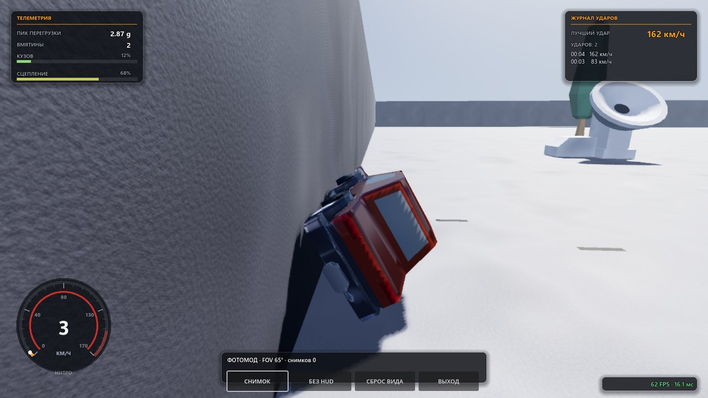
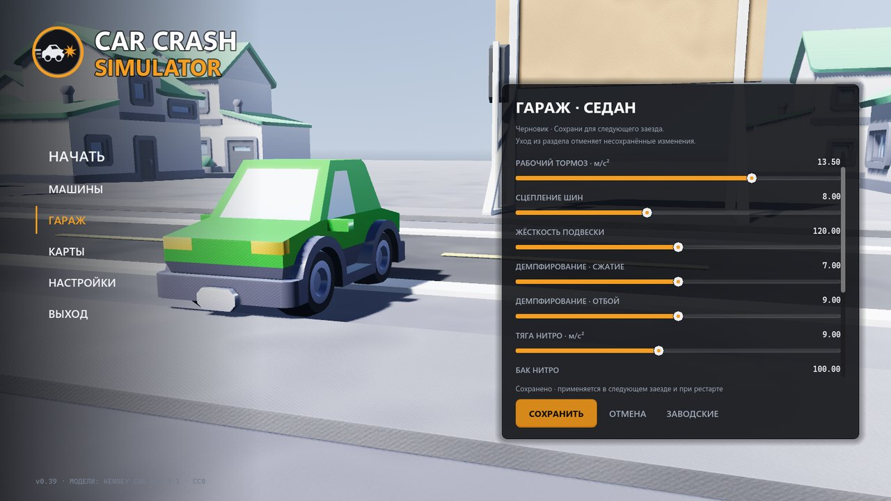
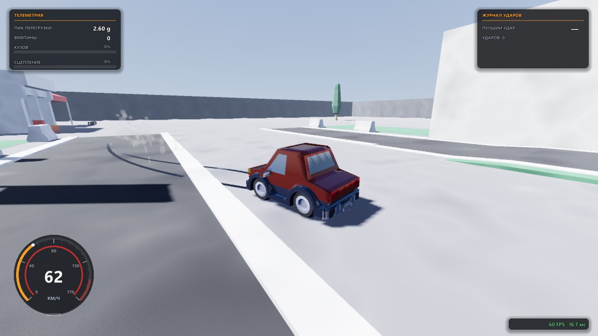

<p align="center">
  
</p>

<p align="center">
  <a href="#что-в-игре"><b>Что в игре</b></a> ·
  <a href="#управление"><b>Управление</b></a> ·
  <a href="#скачать"><b>Скачать</b></a> ·
  <a href="#сборка-из-исходников"><b>Сборка</b></a> ·
  <a href="#тесты"><b>Тесты</b></a> ·
  <a href="CONTRIBUTING.ru.md"><b>Вклад</b></a>
</p>

<p align="center">
  <a href="https://github.com/lightcodegit/carcrashsimulator/actions/workflows/ci.yml"></a>
  
  <a href="https://godotengine.org/download/archive/"></a>
</p>

<p align="center">🌐 <a href="README.md">English</a> · <b>Русский</b></p>

# Car Crash Simulator

**3D-песочница крашей на Godot 4.7.** Разгонитесь, врежьтесь и смотрите, как кузов
сминается ровно в точке удара: телеметрия заезда, реплей последних десяти секунд,
фотомод со свободной камерой, гараж с тюнингом и окраской. Бесплатно,
с открытым исходным кодом (MIT), ассеты CC0.

## Что в игре

Всё перечисленное ниже уже входит в текущий релиз.

- **Деформация.** Вершины кузова смещаются вдоль вектора потери скорости: лобовой,
  боковой и задний удар мнут свою панель; вмятины накапливаются и сбрасываются
  рестартом.
- **5 машин.** От тяжёлого пикапа до машины «Бесконечности» без потолка скорости;
  у каждой свои максималка, масса, разгон и нитро с баком и пламенем из выхлопа.
- **6 карт.** Тестовая арена, город с припаркованными машинами, драг-стрип с
  финишной стеной, километровое кольцо, бесконечная лента плит и большой город
  с кварталами.
- **Реплей удара и фотомод.** Повтор последних 10 секунд с пошаговым перебором и
  скоростью воспроизведения; свободная камера с зумом и PNG-снимками.
- **Гараж.** Жёсткость подвески, амортизаторы, тяга, тормоза, сцепление, бак нитро
  и окраска кузова в любой цвет; профиль хранится отдельно для каждой машины.
- **Звук и вибрация.** Двигатель, визг шин, удар и нитро синтезируются DSP-микшером;
  геймпад вибрирует при ударах и заносах.
- **Настройки и два языка.** Пресеты картинки, каждая опция графики отдельно, слоумо
  и камера; интерфейс на английском и русском, переключение на лету. Каждое действие
  можно переназначить на клавишу, кнопку или ось — клавиатура и геймпад хранятся
  раздельно, модификаторы являются частью назначения.

<table>
  <tr>
    <td width="50%"></td>
    <td width="50%"></td>
  </tr>
</table>

## Производительность

Симуляция стоит ≈1 мс на физический тик (6–7% бюджета шага 16,67 мс) — кадр
ограничен рендером, поэтому рендерер GL Compatibility, а пресеты картинки
рассчитаны от замеренной стоимости кадра. Замерено `tools/project.mjs test`
(`p_perf`, живой рендер) на Intel HD 630 при 1600×900:

| Конфигурация кадра (Compatibility) | Стоимость кадра |
| --- | --- |
| только геометрия, без теней и пост-эффектов, масштаб 70% | **6,7 мс** |
| дымка и свечение, тени 120 м (по умолчанию) | **13,7 мс** |
| всё включено: SSAO/SSIL, MSAA 4×, тени 260 м | 29,4 мс |
| мягкие тени 420 м, bloom, экспозиция 1,15 (film) | 29,2 мс |

Пресет по умолчанию укладывается в частоту 60 Гц на встроенной графике; пресеты
HIGH и FILM — для дискретных GPU.

## Скачать

Готовые сборки публикуются на
[странице релизов](https://github.com/lightcodegit/carcrashsimulator/releases):
workflow `Release` собирает их автоматически по тегу `v*`, а номер тега сверяется
с версией в `project.godot` и записью в `CHANGELOG.md`. До первого тега собирайте
из исходников (ниже) или берите артефакты CI на вкладке Actions.

| Платформа | Файл | Требуется |
| --- | --- | --- |
| Windows x86_64 | `Car Crash Simulator.exe` | Windows 10/11, GPU с OpenGL 3.3 |
| Linux x86_64 | `Car Crash Simulator.x86_64` | дистрибутив с glibc, X11 или Wayland |

Каждая сборка — один файл: данные игры (.pck) вшиты в исполняемый файл, поэтому
рядом с ним держать нечего.

## Управление

| Действие | Клавиатура | Геймпад |
| --- | --- | --- |
| Газ / тормоз | W / S | RT / LT |
| Руление | A/D, ←/→ | левый стик |
| Ручник / стояночный тормоз | Space | A (крест) **или** L1 |
| Нитро (удерживать) | Shift | R1 |
| Слоумо (удерживать) | Ctrl | B |
| Камера (погоня → капот → орбита) | C | X |
| Рестарт | R | Y |
| Пауза | Esc | Start |

Таблица — раскладка по умолчанию. Всё переназначается в
**НАСТРОЙКИ → УПРАВЛЕНИЕ** (из главного меню и из паузы): на клавишу, кнопку или
ось геймпада; `Ctrl+F` и `F` — две разные клавиши, и файл настроек хранит их
вместе с модификаторами.

## Сборка из исходников

Нужен **Godot 4.7.2 stable** (не .NET) и **Node.js >=22** (без npm-зависимостей).
Для экспорта установите шаблоны **4.7.2.stable** через
**Editor → Manage Export Templates** или из
[официального релиза](https://github.com/godotengine/godot-builds/releases/tag/4.7.2-stable);
CI скачивает тот же редактор и те же шаблоны и проверяет SHA-256.

```sh
git clone https://github.com/lightcodegit/carcrashsimulator.git
cd carcrashsimulator
node tools/project.mjs import          # импортировать ресурсы и классы
node tools/project.mjs run             # запустить игру из исходников
node tools/project.mjs build windows   # релиз в artifacts/build/windows/
node tools/project.mjs build linux
```

Godot ищется в PATH как `godot`; задайте переменную `GODOT` или передайте
`--godot "C:/путь с пробелами/Godot.exe"` любой команде. `help <команда>` и
`<команда> --help` описывают опции; import, test и build не открывают окон.
Можно также открыть `project.godot` в редакторе и нажать F5.

## Тесты

```sh
node --test tools/project.test.mjs          # тесты самого раннера, Godot не нужен
node tools/project.mjs import              # сначала импортировать ресурсы и классы
node tools/project.mjs test --list
node tools/project.mjs test --test d_assets --test h_crash --timeout 180
node tools/project.mjs test                # весь набор, параллельно (--jobs N)
node tools/project.mjs test --fail-on-skip # строгий режим: partial/skip тоже ошибка
```

Раннер находит `tests/**/d_*.gd` и `tests/**/h_*.tscn`; `--test` принимает точные
имена из `--list`. Каждый тест получает изолированные директории
`APPDATA`/`HOME`/`XDG_*` в системном temp — настройки игрока и результаты чужих
тестов никогда не попадают в дефолты. Для успеха нужны строка `ALL PASS`, код
выхода 0 и отсутствие `SCRIPT ERROR`/`FAIL`; `PARTIAL`/`SKIP` считаются отдельно
и засчитанными за проход не являются. Тесты, которым нужны живой GPU, окно или
геймпад, в headless честно сообщают о частичном покрытии либо помечены skipped;
их полное покрытие — ручной прогон `p_live_probe` с живым окном (звук, дым,
окраска, реплей и фотомод — по пикселям и с реальным аудиовыводом). CI прогоняет
обе ОС и **всегда запускает собранную игру** в headless на несколько кадров:
«экспортировалось» без «запускается» здесь сборкой не считается.

## Вклад

Процесс и очереди — в [CONTRIBUTING.ru.md](CONTRIBUTING.ru.md). **Язык репозитория
— английский: новые issues, коммиты и pull request пишутся по-английски.** Если
работу делает AI-агент, в том же файле есть раздел «Если вы — агент».

## Лицензия

Код, сцены и тесты — **MIT** (`LICENSE`). Ассеты не наши: в `assets/` лежат CC0
Kenney Car Kit и Racing Kit, тексты их лицензий стоят рядом с файлами и едут в
сборке, а за этим следит тест `d_assets`. «Godot» и «Kenney» — товарные знаки
соответствующих владельцев, упомянуты только чтобы объяснить, на чём это собрано.

Если берёте проект себе: MIT требует сохранять уведомление об авторских правах,
CC0 не требует ничего, но сказать авторам китов спасибо — хорошее тона.

## Автор

Проект написал **crystaldev** ([@lightcodegit](https://github.com/lightcodegit)).

## Участники

По мере появления соавторов GitHub держит полный список в
[графе участников](https://github.com/lightcodegit/carcrashsimulator/graphs/contributors).
